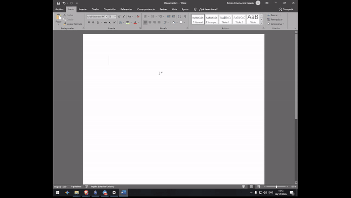

# 🎙️ VozLocal — dictado offline para PCs de bajos recursos

> **Habla. Escribe. Sin nube, sin límites, sin GPU.**

VozLocal es un dictado de voz **100% offline** en **español e inglés** pensado para
**computadoras viejas**. Corre, literalmente, en una **GTX 750 Ti de 2014** con CPU —
sin tarjeta de video, sin internet y sin pagar suscripción.

---

## 🎬 Demo

Pulsas **F9**, hablas, vuelves a pulsar **F9**. El texto se pega en la ventana que tengas
activa, acá va directo a Microsoft Word.



**El mismo demo con audio** - hablado en inglés no nativo, y aun así sale bien: 28 palabras,
sin un solo error. Dale play, tiene sonido.

https://github.com/user-attachments/assets/3358f7b3-5787-49d6-a6be-644522253ea0

**El colgante, ampliado** de esa misma grabación: escuchando con las barritas de voz, después
transcribiendo, después listo.


---

## ✨ Por qué existe

Los dictados modernos (Wispr Flow, etc.) mandan tu voz a la nube y cobran por palabra
o por mes. VozLocal hace lo contrario:

- 🔒 **Tu voz nunca sale de tu PC** — privacidad total.
- 🪙 **Gratis e ilimitado** — cero suscripción, cero límites de palabras.
- 💻 **Corre en hardware humilde** — diseñado y probado en una GTX 750 Ti (CPU-int8).
- 🎧 **ES + EN** — dos teclas, un idioma fiable cada vez (nada de detecciones fallidas).
- ⚡ **Feedback visual en vivo** — un colgante que te muestra *escuchando*, con barritas
  que reaccionan a tu voz real (RMS del micrófono).

---

## 🚀 Empezar

### Requisitos
- Windows 10/11
- Python 3.10+
- Un micrófono

### Instalar dependencias
```bash
pip install faster-whisper sounddevice pynput pyperclip numpy

# opcional: motor rápido Parakeet (ver "Dos motores" abajo)
pip install "sherpa-onnx>=1.10"
```

### Ejecutar
```bash
# desde la carpeta del repo
set PYTHONPATH=%CD%\src
python -m vozlocal
```

O simplemente doble clic en `Dictar.bat` (lanzador preconfeccionado).

---

## ⚡ Dos motores: Parakeet (rápido) o Whisper (clásico)

VozLocal trae **dos motores intercambiables**. Se elige en **Ajustes (F10) → Motor**, sin tocar código.

| Motor | Modelo | Disco | Latencia medida\* | Español |
|---|---|---|---|---|
| **Parakeet** (recomendado) | NVIDIA Parakeet TDT 0.6B v3 int8 — sherpa-onnx / ONNX Runtime | 641 MB | **1.3 s** (6.8 s de voz) · **2.7 s** (20.8 s) | ✅ puntuación, acentos, mayúsculas |
| Whisper | faster-whisper `small` int8 — CTranslate2 | 466 MB | 3.8 s · 4.1 s | bueno, sin puntuación, más erratas |

\* Medido en un **Intel i5-4460** (4 núcleos, 2014), **sin GPU**. La misma grabación en ambos motores:
Whisper escribió `…el estado de la lazaña` y `sigo pensando en lo demónica`; Parakeet escribió
`…el estado de la lasaña` y `sigo pensando en lo de Mónica`.

**Sobre la puntuación:** Parakeet la deduce de la **prosodia**. Si hablás de corrido sin pausas,
devuelve texto plano; con una micro-pausa al final de cada oración, la puntúa. VozLocal además
**capitaliza la primera letra y asegura punto final** (no inventa comas ni signos `¿?`).

### Instalar el motor Parakeet

```bash
pip install "sherpa-onnx>=1.10"     # o: pip install "vozlocal[parakeet]"
```

Descargá el modelo ONNX int8 y descomprimilo en `models/parakeet-tdt-0.6b-v3/`:

```bash
curl -L -o parakeet.tar.bz2 \
  https://github.com/k2-fsa/sherpa-onnx/releases/download/asr-models/sherpa-onnx-nemo-parakeet-tdt-0.6b-v3-int8.tar.bz2
tar xjf parakeet.tar.bz2
mkdir -p models
mv sherpa-onnx-nemo-parakeet-tdt-0.6b-v3-int8 models/parakeet-tdt-0.6b-v3
```

VozLocal busca el modelo en este orden: `DICTATE_PARAKEET_DIR` → `models/parakeet-tdt-0.6b-v3/`
→ `~/.cache/vozlocal/parakeet-tdt-0.6b-v3`. Si no está, avisa y **sigue con Whisper**.

> 💡 **¿No querés descargar nada?** El default sigue siendo **Whisper `small`**: se baja solo la
> primera vez y funciona out-of-the-box. Cambiar de motor es una línea en `config.json`
> (`"engine": "parakeet"`) o un clic en Ajustes.

---

## 🎮 Cómo se usa

| Tecla | Acción |
|---|---|
| **F8** | Dictar en **español** (pulsa para empezar, pulsa de nuevo para escribir) |
| **F9** | Dictar en **inglés** (ídem) |

1. Haz clic en el campo de texto donde quieras escribir (Word, navegador, bloc de notas…).
2. Pulsa **F8** (o **F9**), habla en frases cortas, pulsa la MISMA tecla de nuevo.
3. VozLocal transcribe y **pega el texto en tu app**. El colgante te va indicando el estado.

### El colgante (indicador)
- `🎙️ F8=ES · F9=EN` — inactivo (pill oscuro).
- `Escuchando (ES)` — pill verde con **5 barritas** que siguen tu voz.
- `⏳ Transcribiendo…` — ámbar.
- `✓ Listo` — verde, texto escrito.
- **Clic en el colgante** = colapsar/expandir.

### Atajos y configuración (variables de entorno)
| Variable | Valores | Default | Qué hace |
|---|---|---|---|
| `DICTATE_ENGINE` | `whisper` \| `parakeet` | `whisper` | Motor de transcripción (también en Ajustes). |
| `DICTATE_PARAKEET_DIR` | ruta | `models/parakeet-tdt-0.6b-v3` | Dónde está el modelo Parakeet. |
| `DICTATE_MODEL` | `base` \| `small` | `small` | Solo motor Whisper: `base` = más rápido; `small` = más preciso. |
| `DICTATE_LANG` | `es` \| `en` | auto | Fuerza el idioma (ignora F8/F9). |

---

## ⚙️ Inicio automático con Windows

VozLocal puede arrancar **en segundo plano al encender Windows** (como un "asistente de
dictado" siempre disponible). El lanzador `Dictar.vbs` es silencioso (sin ventana).

- **Activar:** crea un acceso directo en la carpeta de Inicio de Windows que apunte a
  `wscript.exe "ruta-al-Dictar.vbs"`.
- **Desactivar:** elimina ese acceso directo (`Win+R` → `shell:startup`).
- **Ojo RAM:** en reposo el dictado ocupa ~435 MB (modelo `small`). Si tu PC es de pocos
  recursos, inícialo manualmente con `Dictar.bat` solo cuando lo vayas a usar.

---

## 🧠 ¿Cómo funciona?

- **Motores:** [Parakeet TDT 0.6B v3](https://huggingface.co/nvidia/parakeet-tdt-0.6b-v3) int8
  vía [sherpa-onnx](https://github.com/k2-fsa/sherpa-onnx) (rápido, ~641 MB) o
  [faster-whisper](https://github.com/SYSTRAN/faster-whisper) `small` int8 (clásico, ~466 MB).
  Ambos en **CPU (int8)**: no necesitas GPU.
- **Texto:** `clean_text()` colapsa espacios, capitaliza la primera letra y asegura punto final.
- **Silencio:** antes de transcribir se recorta el audio por energía (RMS en tramas de 50 ms)
  para no procesar pausas largas; lo que pasa de 28 s se trocea por el punto más silencioso.
- **UI:** `tkinter` — un pill redondeado (sobre fondo transparente en Windows) que se queda
  encima de todas tus ventanas.
- **Idioma fiable:** cada tecla **fuerza** el idioma en lugar de auto-detectar, que en
  hardware modesto es lento y se equivoca.
- **Barritas de voz:** el callback del micrófono calcula el **RMS** y lo suaviza; la UI lo
  dibuja como 5 barras con leve jitter, así ves tu voz "en vivo".

---

## 🖥️ Requisitos de hardware (medidos)

VozLocal **no necesita GPU**. Todo corre en la CPU. (Medido en esta misma máquina:
Intel i5-4460, 4 núcleos, GTX 750 Ti.)

| Requisito | Mínimo | Recomendado (probado) |
|---|---|---|
| CPU | 2 núcleos x64 | **4 núcleos** (i5-4460 @3.2 GHz) |
| RAM del sistema | 4 GB | 8 GB |
| **RAM en uso (dictado)** | ~200 MB (Whisper `base`) | **~800 MB** (Parakeet) · ~435 MB (Whisper `small`) |
| GPU | ❌ No requerida (CPU int8) | ❌ No requerida |
| Disco libre | ~1 GB | ~2 GB |
| SO | Windows 10 (64-bit) | Windows 11 |
| Micrófono | Cualquiera | USB de buena calidad |

> 💡 Menos es más: con modelo `base` consumes ~200 MB y es más rápido al transcribir,
> a costa de algo de precisión. `small` (default) es el equilibrio.

## 🖥️ En hardware humilde

Probado en una **NVIDIA GTX 750 Ti (2 GB, Maxwell)** con CPU:

| Modelo | Tiempo (~9 s de voz) | Calidad | Nota |
|---|---|---|---|
| `base` | ~2 s | baja | rápido, pero se equivoca |
| **`small`** | ~4.7 s | ✅ buena | **recomendado** (default) |

> 💡 ¿GPU vieja? No la necesitas. faster-whisper en CPU-int8 es la vía correcta
> (las GPUs Maxwell sin FP16 + CUDA 12/cuDNN 9 complican la aceleración). VozLocal
> elige **CPU** a propósito.

*(captura del overlay en `assets/overlay.png` — próximamente)*

---

## 🗺️ Roadmap

- [x] Dictado EN/ES offline con overlay y barritas de voz
- [x] Segundo motor seleccionable (NVIDIA Parakeet TDT 0.6B v3 int8 vía sherpa-onnx)
- [x] Normalización del texto: mayúscula inicial y punto final
- [ ] Posición / colores del colgante configurables
- [ ] Transcribir archivos de audio (clips)
- [ ] Empaquetado como `.exe` portable (PyInstaller)
- [ ] Puntuación y formato del texto con IA (comas, párrafos, listas)

---

## 📦 Compilar un `.exe` portable (PyInstaller)

Para que cualquiera lo corra **sin instalar Python**:

```bash
pip install pyinstaller
pyinstaller --noconfirm --windowed --onedir --name VozLocal --paths src \
  --collect-all ctranslate2 --collect-all faster_whisper --collect-all av \
  --collect-all sounddevice --collect-all pynput --hidden-import pyperclip entry.py
```

Resultado: carpeta `dist\VozLocal\` con `VozLocal.exe` (copiar la carpeta = portable).

- **Modelo:** se descarga **una vez** en el primer arranque (requiere internet esa vez; queda en la caché).
- **Copiar la carpeta entera** (no solo el .exe) — las librerías nativas van al lado.
- El punto de entrada `entry.py` está en la raíz del repo.

## 🧪 Tests

```bash
pytest
```

## 📄 Licencia

MIT — haz lo que quieras, solo deja el aviso. © VozLocal contributors.

---

**Hecho con 🎙️ para que la gente con una PC vieja también pueda dictar.**
